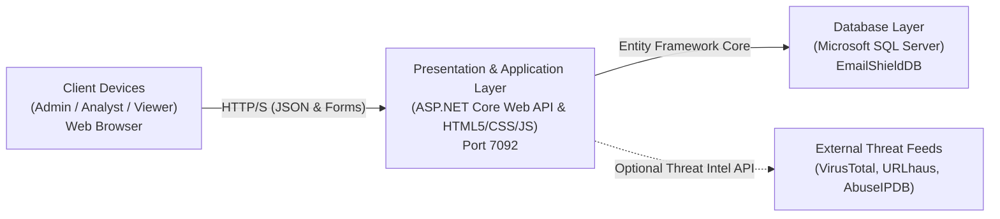

# EmailShield: Suspicious Email Analysis & Phishing Detection System

[](https://dotnet.microsoft.com/)
[](https://www.microsoft.com/sql-server)
[](#network-topology--three-tier-architecture)
[](#security--route-protection)

**Author & Lead Developer:** **Daniel Kent Pelpinosas**  
**Course & Project Domain:** System Administration and Maintenance / Cybersecurity Information Systems  

---

## 📌 Project Description

**EmailShield** is a web-based suspicious email analysis and phishing detection system designed to help organizations identify potentially harmful emails before users interact with them. It allows authorized users to submit suspicious email messages through text input or `.eml` file uploads.

The system analyzes email headers, sender information, embedded URLs, and attachment metadata to identify possible phishing, sender spoofing, malicious links, suspicious attachments, and Business Email Compromise (BEC) indicators.

---

## 🎯 Purpose

To provide a centralized platform that helps IT administrators and security personnel examine suspicious emails, understand potential security threats, classify email risks, and generate analysis reports.

---

## 🔍 Scope

The system includes:
- **Email submission and .eml file uploading**: Dual-mode input via drag-and-drop `.eml` upload or raw email text pasting.
- **Email header and content parsing**: RFC 822 / MIME structure extraction (`From`, `To`, `Reply-To`, `Subject`, `Date`, `Received`, `Return-Path`, `Authentication-Results`).
- **Sender and domain spoofing detection**: Identifies Display Name Impersonation and Reply-To domain divergence.
- **Suspicious URL analysis**: Deep inspection for raw IP addresses, credential-stealing query parameters, high-abuse TLDs (`.xyz`, `.top`, `.click`, `.online`), and deceptive `@` host redirections.
- **Attachment metadata inspection**: Passive, non-executing file metadata evaluation for dangerous extensions (`.exe`, `.scr`, `.bat`), double extensions (`.pdf.exe`), and macro-enabled documents (`.docm`, `.xlsm`).
- **SPF, DKIM, and DMARC verification**: Extracts and interprets cryptographic email authentication headers.
- **Phishing and BEC indicator detection**: Heuristics for artificial urgency, financial coercions, credential harvesting, and payment redirection requests.
- **Risk classification (Low, Medium, High)**: Weighted risk scoring (0–100) mapped to actionable mitigation alerts.
- **Analysis history and dashboard**: Centralized scan archive, personal history, threat metrics, and audit logs.
- **PDF and CSV report generation**: Exportable forensic documentation for security auditing and management review.
- **User authentication and role-based access control**: Dedicated portal boundaries for Administrators, Security Analysts, and Viewers.

---

## 🚀 Project Objectives

1. **Develop a centralized web-based email analysis system** using ASP.NET Core Web API and Microsoft SQL Server that allows authorized users to submit suspicious email samples for examination.
2. **Analyze email headers and sender information** to identify possible spoofing, domain inconsistencies, and email authentication failures.
3. **Inspect embedded URLs and attachment metadata** for indicators associated with phishing, malicious links, and suspicious files without opening or executing attachments.
4. **Classify analyzed emails into risk levels** and provide explanations of the detected warning signs to support user decision-making.
5. **Generate searchable analysis records and exportable security reports** that assist administrators and security personnel in reviewing and documenting suspicious email incidents.

---

## 🏗️ Network Topology & Three-Tier Architecture

EmailShield is built upon a robust **Three-Tier Client-Server Architecture**:



1. **Presentation Layer (Frontend)**:
   - Modern, responsive Dark Cybersecurity Dashboard built with semantic HTML5, CSS3 variables, and vanilla JavaScript.
   - Dynamic tabbed forensic views, live risk dials, data pagination, and responsive dropzones.
2. **Application Layer (Backend Web API)**:
   - ASP.NET Core Web API (.NET 8.0).
   - High-throughput MIME/RFC 822 email parser powered by MimeKit and regex fallbacks.
   - Multi-layer threat scoring engine and forensic rule configuration manager.
   - Built-in QuestPDF reporting engine for automated vector-graphic PDF generation.
3. **Database Layer (Persistence)**:
   - Microsoft SQL Server (SSMS) with indexed relational tables and pre-compiled views (`vw_AnalysisHistory`, `vw_DashboardSummary`).

---

## 🛠️ Technologies and Frameworks

| Layer | Technology | Purpose |
| :--- | :--- | :--- |
| **Backend Language** | C# (.NET 8.0) | High-performance compiled backend logic |
| **Web Framework** | ASP.NET Core Web API | RESTful endpoints for analysis, auth, and reporting |
| **Data Access** | Entity Framework Core 8 | Object-Relational Mapping (ORM) and migrations |
| **Database** | Microsoft SQL Server (SSMS) | Centralized relational data storage |
| **Email & MIME Parsing** | MimeKit & MailKit | RFC 822 / RFC 2822 / MIME message structure parsing |
| **Report Generation** | QuestPDF & CsvHelper | Professional PDF forensic reports and CSV data dumps |
| **Frontend UI** | HTML5, CSS3, JavaScript | Modern cybersecurity dark UI with no heavy frameworks |
| **Security & Cryptography** | PBKDF2 (SHA-256) & Cookie Protection | Secure salted password hashing and tab-isolated sessions |

---

## 🛡️ Detection Techniques & Threat Heuristics

### 1. Sender & Domain Spoofing Analysis
- **Reply-To Mismatch (+20 Pts):** Flags emails where the `Reply-To` address domain diverges from the visible `From` header.
- **Display Name Impersonation (+25 Pts):** Detects when an attacker puts a trusted company address (e.g. `support@paypal.com`) inside the display name string while the actual SMTP address is hosted on an untrusted domain.

### 2. Email Authentication Verification (SPF, DKIM, DMARC)
- Parses `Authentication-Results` and `Received-SPF` headers.
- **SPF Failure (+25 Pts):** Flags unauthorized sender IP addresses.
- **DKIM Failure (+25 Pts):** Flags tampered message bodies or broken digital signatures.
- **DMARC Failure (+25 Pts):** Identifies domain alignment policy rejections.

### 3. Suspicious URL Analysis
- **Raw IP Address URLs (+30 Pts):** Detects links targeting direct IP hosts (e.g. `http://192.168.1.105/login`).
- **High-Abuse Top-Level Domains (+20 Pts):** Matches links against monitored abuse TLDs (`.xyz`, `.top`, `.click`, `.work`, `.rest`, `.online`).
- **Deceptive User-Info Host Obfuscation (+35 Pts):** Detects `@` signs inside URLs used to trick readers on actual destinations.
- **Credential Harvesting Keywords (+15 Pts):** Scans URL path strings for `/login`, `/verify`, `/account-update`, `/banking`.

### 4. Safe Attachment Inspection (Passive Metadata)
- **Zero-Execution Architecture:** Inspects file extensions, MIME signatures, and size without executing or opening attachments.
- **High-Risk Executables (+40 Pts):** Flags `.exe`, `.scr`, `.bat`, `.cmd`, `.vbs`, `.ps1`, `.iso`.
- **Double File Extensions (+45 Pts):** Detects masqueraded payloads such as `Invoice_2026.pdf.exe`.
- **Macro-Enabled Documents (+25 Pts):** Identifies Office files with macros (`.docm`, `.xlsm`).

### 5. Phishing & Business Email Compromise (BEC) Heuristics
- **Artificial Urgency Signals (+15 Pts):** Detects intimidation keywords (`"within 24 hours"`, `"immediate action required"`, `"account suspended"`, `"final notice"`).
- **Credential Harvesting Prompts (+20 Pts):** Identifies requests for credentials, passwords, or PIN resets.
- **Fraudulent Wire Transfer & Payment Rerouting (+25 Pts):** Detects CEO fraud, updated banking coordinates, or emergency wire instructions.

---

## 👥 Role-Based Access Control (RBAC)

The system enforces strict RBAC across three dedicated portals:

| Role | Permitted Actions | Portal Route |
| :--- | :--- | :--- |
| **Administrator** | Manage user accounts, toggle analysis rules, adjust scoring weights, review system-wide scan archives, and inspect security audit logs. | `/admin/` |
| **Security Analyst** | Submit emails (Raw Text / `.eml`), inspect comprehensive forensic reports, export PDF/CSV files, and view team investigation history. | `/analyst/` |
| **Viewer / User** | Submit suspicious emails, view plain-language risk explanations, learn defensive email tips, and view personal submission archive. | `/viewer/` |

---

## 🔒 Security & Route Protection (Anti-Forced Browsing)

EmailShield implements multi-layer defense against **Direct URL Access / Forced Browsing**:
1. **Client-Side Isolated Session Guard:** Uses `sessionStorage` (strictly isolated per browser tab) with immediate execution in the `<head>` of all HTML pages. Pasting a protected link into a new tab or window immediately redirects unauthenticated users back to the login portal.
2. **Server-Side Cookie Validation:** `EmailShield_Session` HttpOnly cookies are verified in the ASP.NET Core middleware pipeline.
3. **Role-Enforced Directory Boundaries:** Unauthorized roles trying to access `/admin/` or `/analyst/` directories are automatically rerouted to their permitted portal.

---

## ⚙️ Installation & Setup Guide

### Prerequisites
- [.NET 8.0 SDK](https://dotnet.microsoft.com/download/dotnet/8.0)
- [Microsoft SQL Server](https://www.microsoft.com/sql-server) (LocalDB, SQLEXPRESS, or Enterprise)
- [SQL Server Management Studio (SSMS)](https://learn.microsoft.com/sql/ssms/download-sql-server-management-studio-ssms)

### 1. Clone the Repository
```bash
git clone https://github.com/daNnn-cmd/EmailShield-A-Web-Based-Suspicious-Email-Analysis-and-Phishing-Detection-System.git
cd EmailShield-A-Web-Based-Suspicious-Email-Analysis-and-Phishing-Detection-System
```

### 2. Configure the Database
1. Open SSMS and connect to your SQL Server instance.
2. Open and run the included SQL script:
   ```text
   Database/EmailShieldDB_Setup.sql
   ```
3. Update your connection string in `appsettings.json`:
   ```json
   {
     "ConnectionStrings": {
       "DefaultConnection": "Data Source=YOUR_SERVER_NAME;Initial Catalog=EmailShieldDB;Integrated Security=True;Trust Server Certificate=True"
     }
   }
   ```

### 3. Run the Application
```bash
dotnet restore
dotnet run
```
4. Open your browser and navigate to:
   ```text
   https://localhost:7092/
   ```

---

## 🧪 Default Test Accounts

| Role | Email Address | Password |
| :--- | :--- | :--- |
| **Administrator** | `admin@school.edu` | `Admin@123` |
| **Security Analyst** | `analyst@school.edu` | `Analyst@123` |
| **Viewer / User** | `viewer@school.edu` | `Viewer@123` |

---

## 🌐 Dual Database & Cloud Synchronization Architecture

EmailShield is designed to seamlessly operate across both local development and live cloud production environments with bi-directional database synchronization:

- **Local SQL Database:** `LAPTOP-1ERS664U\SQLEXPRESS` (Database: `EmailShieldDB`)
- **Deployed Online Database:** `db81100.public.databaseasp.net` (Database: `db81100` on MonsterASP / ASP.NET)

### Key Synchronization Capabilities:
1. **Continuous Automated Sync:** A built-in background worker (`DatabaseSyncBackgroundService`) runs periodically to verify and synchronize new records (Users, Scans, Forensic Findings, and Audit Logs) between Local and Online databases.
2. **On-Demand Web Admin Sync:** Administrators can monitor real-time connection health, row counts, and trigger instantaneous bi-directional synchronization from **Rules & Settings (`/admin/settings.html`)**.
3. **Standalone PowerShell Automation:** Run `Database/Sync-Databases.ps1` at any time from terminal or scheduled tasks:
   ```powershell
   powershell -ExecutionPolicy Bypass -File Database/Sync-Databases.ps1
   ```
4. **Resilient Offline Fallback:** If internet access is unavailable on the local machine, the application safely operates using the local SQL database without interruption and automatically reconciles when reconnected.

---

## 📄 License & Attribution

Developed by **Daniel Kent Pelpinosas** for the **EmailShield Suspicious Email Analysis and Phishing Detection System** project.  
All rights reserved. Unauthorized reproduction or deployment without permission is prohibited.

